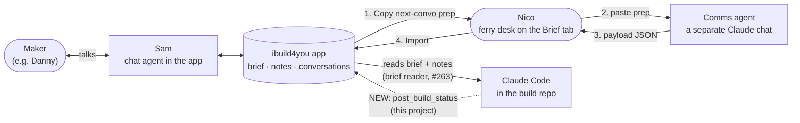
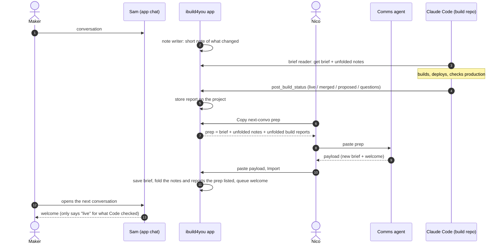
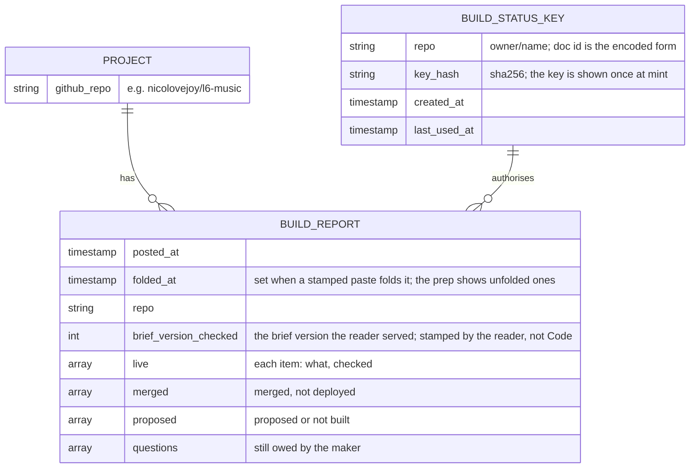

# Build status back to the prep (the return leg)

Date: 2026-11-15. Status: approved by Nico, 2026-11-15, with the seven review changes folded in (read route, key lookup by repo, reader-stamped brief version, report size and cap, match function, duplicate drop, key fetch order). Part of the relay-efficiency programme (`2026-11-15-relay-efficiency-design.md`). It replaces that spec's "GitHub-issue mirror" project.

## In one paragraph

Claude Code in a build repo already reads the brief and notes through the brief reader (#263). This project adds the way back: the same reader gets one more tool, `post_build_status`, which sends Code's status report to the ibuild4you app. The app keeps it, and the next "Copy next-convo prep" puts it in front of the comms agent. Nico stops copying Code's reports by hand. Nothing goes through GitHub, so it works for public repos too.

## How the relay works

### The people and agents



The solid lines exist today. The dotted line is this project. Before #263, Nico also carried the brief to Code by hand. Before this project, he carries Code's report to the comms agent by hand.

### One round, start to finish



Steps 5 and 6 are new. Step 8's prep gains the reports. Everything else is unchanged.

### What gets stored



## Why

Code's reports reach the comms agent only when Nico pastes them. They go stale on the way, and "live" sometimes means "merged" (the F4FC problem statement, groups 4 and 5). Project 2 gave l6-music four rules for writing a report. This project gives the report a route that doesn't depend on Nico, and a shape that makes the main rule hard to break: every item listed as live has to say what was checked in production.

## Goals

- Code posts its status in one tool call, and the next prep shows it with no step from Nico.
- A report can't call something live without saying what was checked.
- The comms agent can tell which brief version Code was working from.

## Non-goals

- Showing reports on the Brief tab. Nico decided the prep is enough (2026-11-15). The copy-prep confirmation says how many reports it included, and that's all.
- Sam reading reports directly. Only the comms agent sees them, and the maker hears about them through the welcome it writes.
- Cloud sessions. Every build-repo session since 2026-10-15 ran locally on the laptop (prompt history), and the reader is local only.
- The app checking production itself. The app trusts Code's `checked` field. It records the claim and doesn't verify it.

## Anti-goals

- Maker names, emails or brief contents on GitHub or anywhere else public.
- A credential that can change the brief, the notes or the project settings. The status key can only add a report.
- A model call. Posting and storing a report costs nothing metered (#84 cost routing).

## Approaches considered

1. **A write tool on the brief reader, through an app endpoint with a per-repo key. Picked by Nico, 2026-11-15.** Code calls it the way it already calls the read tools. The key can add a report and nothing else. Nothing goes through GitHub. Cost: one more key per build repo, minted once.
2. **Code writes a status file in its repo and the app reads it from GitHub.** Simplest for Code. Ruled out because tideline, prntd and ibuild4you are public, so the report would be too.
3. **A paste box on the Brief tab for Code's report.** No keys. Nico is still the messenger, so it saves one step and misses the point.
4. **A GitHub issue per repo holding the brief and notes, with Code commenting on it** (the original programme recommendation). Its forward half is already done by the reader, and the public repos rule it out.

## The design

### The endpoint

`POST /api/build-status`, with `Authorization: Bearer <build status key>`.

- The body names the repo (`owner/name`; the reader sends its own `--repo`). The server loads `build_status_keys/{encoded repo}` by id, hashes the presented key (sha256) and compares in constant time, the same code path as `loop_read_keys` (`lib/feedback/read-keys.ts`), where the request names the app. No query by hash. A missing key document, a missing key or a wrong key all get 401 with no detail.
- The body names the project by slug. The server refuses (403) a project whose `github_repo` doesn't match the key's repo, using the server's `reposMatch` (`lib/github/repo.ts`). A project that stores a bare name (`byside`) therefore accepts a `nicolovejoy/byside` key; that is the intended family match, and it has a test.
- The body is the report (below). A malformed report gets 400 with the field that failed, so Code can fix it and retry.
- On success the server adds a document to `projects/{id}/build_reports`, stamps `posted_at` with server time and updates `last_used_at` on the key. It returns `{ ok: true, posted_at }`.
- A retry must not make a second report: if the body is identical to that project's latest report and that one was posted in the last ten minutes, the server stores nothing and returns the existing `posted_at` with `duplicate: true`.
- The key can do nothing else: no reads, no other writes.

### The report

```json
{
  "repo": "nicolovejoy/l6-music",
  "project": "f4fc",
  "brief_version_checked": 55,
  "live": [{ "what": "Bar ranges on the practice screen", "checked": "deployed commit a1b2c3d on l6music.app, page loads" }],
  "merged": ["Two-game split, merged as PR 88, not deployed"],
  "proposed": ["Teacher view of all students"],
  "questions": ["Should a missed day reset the streak?"]
}
```

- A report says what this session did and found, not the whole state of the repo. (Builder-check call: with folding below, every report reaches a prep once, so changes-only reports never repeat an item, and none is lost to a cap.) The tool description says so.
- Every `live` item needs a non-empty `checked`. Without one the server returns 400 and says the item belongs in `merged`. This is project 2's first rule, now enforced by the data shape.
- `brief_version_checked` is required by the endpoint, and Code never types it. The reader remembers the version it last served through `get_brief` for each slug in this session and adds it to the post. If it has served none for that slug, the tool refuses before posting: "Read the brief with get_brief first." (Code stamps, never the model, as with decision provenance.) The prep flags a report made from an older brief than the live one.
- Lists may be empty, but at least one must have something in it.
- Limits: 30 items per list, 500 characters per string, 4,000 characters in total. Anything over gets 400.

### The reader's tool

`scripts/mcp-briefs.mjs` gains `post_build_status`. Its input is the project slug and the four lists; the reader adds `repo` and `brief_version_checked` itself.

- The launcher (`scripts/brief-reader.mjs`) also fetches the repo's status key from 1Password at start (item `ibuild4you-build-status-<owner>-<name>`, field `password`, vault `dev-secrets`), in the same start that fetches the read-only key, and keeps it in memory the same way. It fetches the read-only key first and the status key second, so a refused or missing status key never blocks the read-only start. Two fetches in one launcher process should need one Touch ID; that is an expectation, and the plan has a step where Nico checks it with `--check`.
- The tool is always registered. When the reader has no status key, the reader still starts (read-only, as today) and the tool answers with the reason and the fallback: "No build status key for owner/name (not minted / 1Password did not answer). Give your report to Nico instead." The launcher tells the two cases apart and logs the same reason as one stderr line. (Builder-check call: a tool that silently disappears leaves Code's rule with no fallback.)
- The tool posts to `https://ibuild4you.com/api/build-status` (overridable for preview by a flag on the launcher) and returns the server's answer as text, including any 400 message, so Code can correct the report.
- The tool's description carries project 2's four rules in short, so the shape and the rules arrive together in any repo, not only l6-music.

### Minting a key

On the Setup tab of a project with a `github_repo`, a system admin sees "Build status key for owner/name" with **Mint**. Minting shows the key once in a plain read-only field with **Copy** (as `/admin/apps/<slug>` does for Loop read keys since PR #260), plus a paste-ready `op item create` line for the 1Password item the launcher reads. Minting again replaces the old key, which stops working at once. **Revoke** deletes it. A repo shared by two projects has one key, shown on both projects' Setup tabs.

A key belongs to the full `owner/name`, lowercased. Some projects store a bare name (`byside`); on those the Setup tab asks for `github_repo` to be set to `owner/name` before Mint is offered. The key document's id is the repo with `/` encoded (Firestore ids can't contain `/`). The endpoint's 403 check uses the reader's existing match rule against the key's full repo. (Builder-check call.)

### The prep

The next-convo prep (`lib/agent/next-convo-prompt.ts`) gains a `<build_status>` block after the notes:

- Every unfolded report, oldest first (so the comms agent reads them in the order the work happened). Each shows its date and time (Pacific), the brief version it was made from, and the four lists.
- Folding works like notes (#229): the prep's `_prep_stamp` gains `report_ids` beside `note_ids`; a stamped paste through `PUT /api/briefs` sets `folded_at` on exactly those reports, in the same batch that folds the notes. A report posted after the prep was copied is not in the stamp, stays unfolded and shows in the next prep. An unstamped paste folds nothing. The stale-prep guard is unchanged: reports don't make a prep stale, because a missed report just waits for the next one. (Builder-check call: filtering by `payload_pasted_at` would lose a report posted mid-curation, and compared a client clock with a server one.)
- `parsePrepStamp` accepts a stamp without `report_ids` (every stamp made before this ships).
- If the unfolded reports exceed 15,000 characters, the prep includes the newest that fit (shown oldest first) and says how many older ones were left out. The stamp's `report_ids` lists every report that was unfolded at copy time, left out or not, so the paste folds the left-out ones too. (Nico's call, 2026-11-15: an old report must not come back in a later prep looking new; the newest is the one that matters.) Builder's call on the exact figure.
- The Brief tab builds the prep in the browser, so it needs the reports: `GET /api/build-status?project_id=…` (builder and up, the same check as the notes read) returns the unfolded reports and the date of the latest one. A React Query hook beside the notes hook feeds `buildNextConvoPrompt`.
- A report made from a brief version older than the live brief gets the line "made from v54; the brief is now v55, so check its questions against the brief".
- No unfolded reports: one line, "No new build report since the brief was last curated", with the date of the latest report if there is one.

The prep's welcome rule (A2, PR #261) changes "Live means it is in `shipped`, or the builder told you in this chat" to: in `shipped`, in a build report's `live` list, or the builder told you in this chat. The comms agent is told to move a report's `live` items into `shipped` with the report's date, and to check its `questions` against the brief and notes before passing any to the maker.

The copy-prep confirmation (`lib/copy.ts`) adds "Includes 2 build reports from Code." when there are any.

### What changes in the build repos

l6-music's second rule ("a status report is for the comms agent") changes to "post it with `post_build_status`". This goes in the same handoff that registers the reader there. byside and prntd get the tool when they move to the launcher.

## Order and dependencies

Builds on PR #261 (the prep's welcome rule) and PR #263 (the launcher). Start after both merge. One PR is fine. If it gets large, split it: endpoint, keys and minting first, then the reader tool and the prep.

## Tests

- Endpoint: wrong or missing key, or no key document for the repo → 401; key for another repo → 403; a bare stored `github_repo` accepts the full-name key; a live item without `checked` → 400 naming it; over the limits → 400; a good report is stored with server time and `last_used_at` is updated; an identical report within ten minutes is not stored twice.
- Read route: builder and up only; unfolded reports only.
- Prep: unfolded reports only, oldest first; the size cap and its "left out" line, with the left-out ids still in the stamp; the stale-version line; the no-report line; the changed welcome rule text; `report_ids` in the stamp.
- Paste: a stamped paste folds exactly the listed reports, including ones the cap left out; a report posted after the copy stays unfolded; an old stamp without `report_ids` still parses and folds no reports.
- Reader: with no key, the tool is still listed and answers with the reason and the fallback; the two reasons are told apart; the tool refuses when `get_brief` was not called for that slug; it sends the served version and its own repo; it passes a 400's message through.
- Mint: the key is shown once, a re-mint invalidates the old key, revoke deletes it.

**Where each part is checked.** The endpoint, keys and minting run on preview: mint a key on preview's Setup tab, then post with a small script (`scripts/smoke-build-status.mjs --base … --key-file …`). The reader reads prod Firestore, so its end-to-end post is prod-only. The first real one is l6-music's first report, checked by copying the F4FC prep. Keys are minted on preview only for that smoke test. (Builder-check call.)

## Left to the builder

- Field names inside the stored document, and whether `build_reports` needs a composite index (posted_at within a project should not).
- Wording of the tool description, the stderr line and the prep lines, within what's said here.
- Whether the reader's `get_brief` also shows the latest report back to Code.
